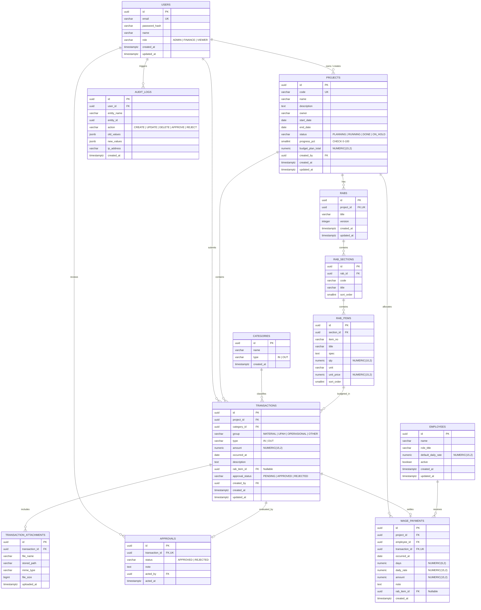

# Product Requirements Document (PRD) & Technical Specification
## Project: Fluxo — Sistem Manajemen Cashflow & Anggaran Proyek

| Metadata | Keterangan |
| :--- | :--- |
| **Nama Sistem** | Fluxo |
| **Versi Spesifikasi** | 1.0.0-SDD |
| **Status** | Approved for Implementation |
| **Database Engine** | PostgreSQL 16+ (Native Driver / No-ORM) |
| **Arsitektur** | Monorepo (Express REST API Backend + React 19 Client) |

---

## 1. Executive Summary & Problem Statement

Fluxo adalah sistem manajemen keuangan dan cashflow terintegrasi berbasis proyek konstruksi dan operasional. Sistem ini memantau alur kas masuk (Kas Masuk / IN) dan kas keluar (Kas Keluar / OUT), menghubungkan realisasi pengeluaran dengan Rencana Anggaran Biaya (RAB / BOQ), mengelola siklus persetujuan (approval workflow) transaksi pengeluaran, serta menghitung upah tenaga kerja harian (SDM).

### Masalah Utama yang Diselesaikan
1. **Kebocoran Anggaran**: Pengeluaran proyek sering melampaui RAB tanpa deteksi dini.
2. **Disiplin Approval**: Pengeluaran lapangan rawan terjadi tanpa verifikasi bukti bayar (struk/bon/faktur) dan otorisasi manajemen.
3. **Pencatatan Upah Terfragmentasi**: Pembayaran upah tukang/mandor sering dicatat terpisah dari buku kas proyek.
4. **Ketiadaan Audit Trail**: Ketiadaan riwayat perubahan status transaksi membuka celah manipulasi laporan keuangan.

---

## 2. Definisi Kebutuhan Fungsional (EARS Syntax)

Kebutuhan sistem didefinisikan menggunakan standar sintaks EARS (*Easy Approach to Requirements Syntax*):

### 2.1. Ubiquitous Requirements (Selalu Berlaku)
- **REQ-UBI-01**: Sistem SHALL mencatat seluruh nominal moneter dalam presisi desimal pasti menggunakan tipe data `NUMERIC(15,2)` untuk mencegah galat pembulatan floating-point.
- **REQ-UBI-02**: Sistem SHALL membatasi akses setiap endpoint API menggunakan JSON Web Token (JWT) yang diverifikasi pada layer middleware, kecuali untuk endpoint publik `/api/health` dan `/api/auth/login`.
- **REQ-UBI-03**: Sistem SHALL merekam setiap aksi perubahan status persetujuan, modifikasi transaksi, dan pengubahan anggaran ke dalam tabel `audit_logs` secara append-only.

### 2.2. Event-Driven Requirements (Berdasarkan Pemicu)
- **REQ-EVT-01**: WHEN pengguna membuat transaksi bertipe `IN`, sistem SHALL menetapkan status approval langsung menjadi `APPROVED` dan memperbarui kalkulasi kas masuk pada proyek terkait.
- **REQ-EVT-02**: WHEN pengguna membuat transaksi bertipe `OUT`, sistem SHALL menetapkan status approval default menjadi `PENDING` dan mengirimkan entri ke antrean approval.
- **REQ-EVT-03**: WHEN pengguna dengan role `ADMIN` menyetujui transaksi (`APPROVED`), sistem SHALL memperbarui akumulasi `budget_used` pada proyek dan item RAB terkait secara atomik dalam satu transaksi basis data (`BEGIN ... COMMIT`).
- **REQ-EVT-04**: WHEN pengguna dengan role `ADMIN` menolak transaksi (`REJECTED`), sistem SHALL menyimpan catatan alasan penolakan dan mengecualikan nominal transaksi dari perhitungan kas keluar aktual.
- **REQ-EVT-05**: WHEN pengguna mencatat pembayaran upah tenaga kerja pada modul SDM, sistem SHALL secara otomatis membuat entri `transactions` bertipe `OUT` dengan grup `UPAH` dan status `PENDING` dalam transaksi database yang sama.
- **REQ-EVT-06**: WHEN file bukti pembayaran diunggah (MIME type: `image/jpeg`, `image/png`, `image/webp`, `application/pdf`, maks. 5MB), sistem SHALL memvalidasi magic bytes file, menyimpannya ke storage, dan menyimpan path relatif serta metadata pada tabel `transaction_attachments`.

### 2.3. State-Driven Requirements (Berdasarkan State Sistem)
- **REQ-STA-01**: WHILE status transaksi bernilai `APPROVED`, sistem SHALL melarang mutasi (UPDATE atau DELETE) terhadap nominal (`amount`), proyek (`project_id`), dan item RAB (`rab_item_id`) transaksi tersebut.
- **REQ-STA-02**: WHILE status proyek bernilai `DONE` atau `ON_HOLD`, sistem SHALL menolak pembuatan transaksi baru untuk proyek tersebut.
- **REQ-STA-03**: WHILE pengguna terautentikasi dengan role `VIEWER`, sistem SHALL menyembunyikan aksi mutasi (tombol create, update, delete, approve, reject) dan mengembalikan respons HTTP `403 Forbidden` jika endpoint mutasi diakses secara langsung.

### 2.4. Unwanted Behavior Requirements (Penanganan Error)
- **REQ-ERR-01**: IF input nominal transaksi bernilai `<= 0` atau bukan angka valid, THEN sistem SHALL menolak permintaan dengan kode status HTTP `400 Bad Request` dan pesan error terstruktur.
- **REQ-ERR-02**: IF transaksi `OUT` diajukan dengan referensi `rab_item_id` yang tidak terdaftar dalam proyek bersangkutan, THEN sistem SHALL membatalkan transaksi dan mengembalikan HTTP `422 Unprocessable Entity`.
- **REQ-ERR-03**: IF terjadi kegagalan query SQL di tengah eksekusi transaksi database majemuk, THEN sistem SHALL mengeksekusi `ROLLBACK` penuh dan mengembalikan HTTP `500 Internal Server Error` tanpa membocorkan stack trace mentah ke klien.

---

## 3. Arsitektur Data: PostgreSQL (Native / No-ORM)

### 3.1. Rationale Penggunaan Native Driver (`pg`) Tanpa ORM
1. **Performa & Zero Overhead**: Menghilangkan abstraksi relasional-objek (ORM mapping overhead) sehingga eksekusi query berlangsung dengan latensi minimal (<10ms untuk beban operasional standar).
2. **Integritas Finansial Penuh**: Kontrol mutlak atas blok transaksi ACID (`BEGIN`, `COMMIT`, `ROLLBACK`) dengan level isolasi terukur (`READ COMMITTED` / `SERIALIZABLE`).
3. **Query Plan Predictability**: Menghindari anomali *N+1 query problem* dan query SQL sub-optimal yang lazim dihasilkan oleh query generator ORM.
4. **Optimasi Aggregasi Kompleks**: Agregasi laporan kas masuk, keluar, sisa budget, dan perbandingan RAB dapat dituliskan langsung via Common Table Expressions (CTE) dan fungsi analitik PostgreSQL.

### 3.2. Normalized Mermaid Entity Relationship Diagram (ERD)



### 3.3. Skema DDL & Indeks PostgreSQL (Production-Grade)

```sql
-- Ekstensi UUID
CREATE EXTENSION IF NOT EXISTS "pgcrypto";

-- Enum Types
CREATE TYPE user_role AS ENUM ('ADMIN', 'FINANCE', 'VIEWER');
CREATE TYPE project_status AS ENUM ('PLANNING', 'RUNNING', 'DONE', 'ON_HOLD');
CREATE TYPE tx_type AS ENUM ('IN', 'OUT');
CREATE TYPE tx_group AS ENUM ('MATERIAL', 'UPAH', 'OPERASIONAL', 'OTHER');
CREATE TYPE approval_status AS ENUM ('PENDING', 'APPROVED', 'REJECTED');

-- Tabel Pengguna
CREATE TABLE users (
    id UUID PRIMARY KEY DEFAULT gen_random_uuid(),
    email VARCHAR(255) NOT NULL UNIQUE,
    password_hash VARCHAR(255) NOT NULL,
    name VARCHAR(150) NOT NULL,
    role user_role NOT NULL DEFAULT 'VIEWER',
    created_at TIMESTAMPTZ NOT NULL DEFAULT CURRENT_TIMESTAMP,
    updated_at TIMESTAMPTZ NOT NULL DEFAULT CURRENT_TIMESTAMP
);

-- Tabel Proyek
CREATE TABLE projects (
    id UUID PRIMARY KEY DEFAULT gen_random_uuid(),
    code VARCHAR(50) NOT NULL UNIQUE,
    name VARCHAR(255) NOT NULL,
    description TEXT,
    owner VARCHAR(150) NOT NULL,
    start_date DATE NOT NULL,
    end_date DATE NOT NULL,
    status project_status NOT NULL DEFAULT 'PLANNING',
    progress_pct SMALLINT NOT NULL DEFAULT 0 CHECK (progress_pct >= 0 AND progress_pct <= 100),
    budget_plan_total NUMERIC(15,2) NOT NULL DEFAULT 0.00 CHECK (budget_plan_total >= 0),
    created_by UUID REFERENCES users(id) ON DELETE SET NULL,
    created_at TIMESTAMPTZ NOT NULL DEFAULT CURRENT_TIMESTAMP,
    updated_at TIMESTAMPTZ NOT NULL DEFAULT CURRENT_TIMESTAMP
);
CREATE INDEX idx_projects_status ON projects(status);

-- Tabel Kategori
CREATE TABLE categories (
    id UUID PRIMARY KEY DEFAULT gen_random_uuid(),
    name VARCHAR(100) NOT NULL,
    type tx_type NOT NULL,
    created_at TIMESTAMPTZ NOT NULL DEFAULT CURRENT_TIMESTAMP
);

-- Tabel Master RAB
CREATE TABLE rabs (
    id UUID PRIMARY KEY DEFAULT gen_random_uuid(),
    project_id UUID NOT NULL UNIQUE REFERENCES projects(id) ON DELETE CASCADE,
    title VARCHAR(255) NOT NULL,
    version INT NOT NULL DEFAULT 1,
    created_at TIMESTAMPTZ NOT NULL DEFAULT CURRENT_TIMESTAMP,
    updated_at TIMESTAMPTZ NOT NULL DEFAULT CURRENT_TIMESTAMP
);

-- Section RAB (Misal: Section A - Pekerjaan Tanah)
CREATE TABLE rab_sections (
    id UUID PRIMARY KEY DEFAULT gen_random_uuid(),
    rab_id UUID NOT NULL REFERENCES rabs(id) ON DELETE CASCADE,
    code VARCHAR(20) NOT NULL,
    title VARCHAR(255) NOT NULL,
    sort_order SMALLINT NOT NULL DEFAULT 0
);
CREATE INDEX idx_rab_sections_rab_id ON rab_sections(rab_id);

-- Line Items RAB
CREATE TABLE rab_items (
    id UUID PRIMARY KEY DEFAULT gen_random_uuid(),
    section_id UUID NOT NULL REFERENCES rab_sections(id) ON DELETE CASCADE,
    item_no VARCHAR(20) NOT NULL,
    title VARCHAR(255) NOT NULL,
    spec TEXT,
    qty NUMERIC(10,2) NOT NULL CHECK (qty >= 0),
    unit VARCHAR(30) NOT NULL,
    unit_price NUMERIC(15,2) NOT NULL CHECK (unit_price >= 0),
    sort_order SMALLINT NOT NULL DEFAULT 0
);
CREATE INDEX idx_rab_items_section_id ON rab_items(section_id);

-- Tabel Transaksi Kas
CREATE TABLE transactions (
    id UUID PRIMARY KEY DEFAULT gen_random_uuid(),
    project_id UUID NOT NULL REFERENCES projects(id) ON DELETE RESTRICT,
    category_id UUID NOT NULL REFERENCES categories(id) ON DELETE RESTRICT,
    tx_group tx_group NOT NULL,
    tx_type tx_type NOT NULL,
    amount NUMERIC(15,2) NOT NULL CHECK (amount > 0),
    occurred_at DATE NOT NULL,
    description TEXT NOT NULL,
    rab_item_id UUID REFERENCES rab_items(id) ON DELETE SET NULL,
    approval_status approval_status NOT NULL DEFAULT 'PENDING',
    created_by UUID REFERENCES users(id) ON DELETE SET NULL,
    created_at TIMESTAMPTZ NOT NULL DEFAULT CURRENT_TIMESTAMP,
    updated_at TIMESTAMPTZ NOT NULL DEFAULT CURRENT_TIMESTAMP
);
CREATE INDEX idx_tx_project_date ON transactions(project_id, occurred_at DESC);
CREATE INDEX idx_tx_status_type ON transactions(approval_status, tx_type);

-- Lampiran Bukti Transaksi
CREATE TABLE transaction_attachments (
    id UUID PRIMARY KEY DEFAULT gen_random_uuid(),
    transaction_id UUID NOT NULL REFERENCES transactions(id) ON DELETE CASCADE,
    file_name VARCHAR(255) NOT NULL,
    stored_path VARCHAR(500) NOT NULL,
    mime_type VARCHAR(100) NOT NULL,
    file_size BIGINT NOT NULL,
    uploaded_at TIMESTAMPTZ NOT NULL DEFAULT CURRENT_TIMESTAMP
);
CREATE INDEX idx_tx_attachments_tx ON transaction_attachments(transaction_id);

-- Riwayat Approval
CREATE TABLE approvals (
    id UUID PRIMARY KEY DEFAULT gen_random_uuid(),
    transaction_id UUID NOT NULL UNIQUE REFERENCES transactions(id) ON DELETE CASCADE,
    status approval_status NOT NULL CHECK (status IN ('APPROVED', 'REJECTED')),
    note TEXT,
    acted_by UUID NOT NULL REFERENCES users(id) ON DELETE RESTRICT,
    acted_at TIMESTAMPTZ NOT NULL DEFAULT CURRENT_TIMESTAMP
);

-- Master SDM / Tenaga Kerja
CREATE TABLE employees (
    id UUID PRIMARY KEY DEFAULT gen_random_uuid(),
    name VARCHAR(150) NOT NULL,
    role_title VARCHAR(100) NOT NULL,
    default_daily_rate NUMERIC(15,2) NOT NULL DEFAULT 0.00 CHECK (default_daily_rate >= 0),
    active BOOLEAN NOT NULL DEFAULT TRUE,
    created_at TIMESTAMPTZ NOT NULL DEFAULT CURRENT_TIMESTAMP,
    updated_at TIMESTAMPTZ NOT NULL DEFAULT CURRENT_TIMESTAMP
);

-- Pembayaran Upah SDM
CREATE TABLE wage_payments (
    id UUID PRIMARY KEY DEFAULT gen_random_uuid(),
    project_id UUID NOT NULL REFERENCES projects(id) ON DELETE RESTRICT,
    employee_id UUID NOT NULL REFERENCES employees(id) ON DELETE RESTRICT,
    transaction_id UUID NOT NULL UNIQUE REFERENCES transactions(id) ON DELETE CASCADE,
    occurred_at DATE NOT NULL,
    days NUMERIC(6,2) NOT NULL CHECK (days > 0),
    daily_rate NUMERIC(15,2) NOT NULL CHECK (daily_rate >= 0),
    amount NUMERIC(15,2) NOT NULL CHECK (amount >= 0),
    note TEXT,
    rab_item_id UUID REFERENCES rab_items(id) ON DELETE SET NULL,
    created_at TIMESTAMPTZ NOT NULL DEFAULT CURRENT_TIMESTAMP
);
CREATE INDEX idx_wage_project ON wage_payments(project_id);
CREATE INDEX idx_wage_employee ON wage_payments(employee_id);

-- Audit Log Append-Only
CREATE TABLE audit_logs (
    id UUID PRIMARY KEY DEFAULT gen_random_uuid(),
    user_id UUID REFERENCES users(id) ON DELETE SET NULL,
    entity_name VARCHAR(50) NOT NULL,
    entity_id UUID NOT NULL,
    action VARCHAR(20) NOT NULL,
    old_values JSONB,
    new_values JSONB,
    ip_address VARCHAR(45),
    created_at TIMESTAMPTZ NOT NULL DEFAULT CURRENT_TIMESTAMP
);
CREATE INDEX idx_audit_entity ON audit_logs(entity_name, entity_id);
CREATE INDEX idx_audit_created ON audit_logs(created_at DESC);
```

---

## 4. Pola Arsitektur Backend (PostgreSQL No-ORM Implementation)

Untuk menjamin kode bersih, aman dari SQL Injection, dan mudah di-maintain, arsitektur backend mengadopsi 3 layer:

```
[ Express Route Controllers ]
           │
           ▼
[ Domain Service Layer ] ─── (Business Rules & Validations)
           │
           ▼
[ Data Access Layer (Repositories) ]
           │
           ├── db.query(sql, params)   --> Parameterized Query via pg.Pool
           └── withTransaction(async (client) => { ... }) --> Atomic ACID Block
```

### 4.1. Modul Koneksi Pool (`server/src/db/pool.js`)
```javascript
import pg from 'pg';
const { Pool } = pg;

export const pool = new Pool({
  connectionString: process.env.DATABASE_URL,
  max: 20,
  idleTimeoutMillis: 30000,
  connectionTimeoutMillis: 5000,
});

export async function query(text, params) {
  const start = Date.now();
  const res = await pool.query(text, params);
  const duration = Date.now() - start;
  if (process.env.NODE_ENV !== 'production' && duration > 100) {
    console.warn(`[Slow Query] ${duration}ms: ${text}`);
  }
  return res;
}

export async function withTransaction(callback) {
  const client = await pool.connect();
  try {
    await client.query('BEGIN');
    const result = await callback(client);
    await client.query('COMMIT');
    return result;
  } catch (err) {
    await client.query('ROLLBACK');
    throw err;
  } finally {
    client.release();
  }
}
```

---

## 5. Matriks Akses Kontrol Berbasis Peran (Sandhu RBAC Matrix)

| Resource / Endpoint | ADMIN | FINANCE | VIEWER |
| :--- | :---: | :---: | :---: |
| **Auth: Register & User Management** | RW | - | - |
| **Project: View List & Detail** | R | R | R |
| **Project: Create & Edit** | RW | - | - |
| **RAB: View** | R | R | R |
| **RAB: Create, Edit, Import** | RW | RW | - |
| **Transaksi: View** | R | R | R |
| **Transaksi: Create (IN / OUT)** | RW | RW | - |
| **Approval: View Pending** | R | R | - |
| **Approval: Approve / Reject Action** | RW | - | - |
| **SDM: View Master & Upah** | R | R | - |
| **SDM: Tambah Karyawan & Bayar Upah**| RW | RW | - |
| **Laporan: Cashflow & Realisasi** | R | R | R |
| **Audit Logs: View** | R | - | - |

*Keterangan:* `RW` = Read + Write/Execute; `R` = Read Only; `-` = No Access (HTTP 403 Forbidden).

---

## 6. Spesifikasi Kontrak API (OpenAPI 3.1 Standard)

Semua endpoint API diawali dengan `/api`. Format payload respons standar:
- **Sukses**: `{ "ok": true, "data": ... }`
- **Gagal**: `{ "ok": false, "error": { "code": "STRING", "message": "STRING", "details": ... } }`

### Ringkasan Endpoint Utama

#### 6.1. Auth
- `POST /api/auth/login`: Autentikasi email & password. Mengembalikan `accessToken` (JWT 12h) dan data profil.
- `GET /api/me`: Mengambil data pengguna aktif via header `Authorization: Bearer <token>`.

#### 6.2. Projects
- `GET /api/projects`: Mengambil daftar proyek (mendukung filter query `?status=RUNNING`).
- `POST /api/projects`: Membuat proyek baru (`ADMIN` only).
- `GET /api/projects/:id`: Mengambil detail proyek, progres, budget total, dan budget terpakai.
- `PATCH /api/projects/:id`: Memperbarui status, progres, atau tanggal proyek.

#### 6.3. Transaksi & Approval
- `GET /api/transactions`: Mengambil riwayat transaksi (query: `projectId`, `type`, `approvalStatus`, `group`, `search`, `page`, `limit`).
- `POST /api/transactions`: Membuat transaksi baru (IN langsung APPROVED, OUT status PENDING). Mendukung upload multipart bukti pembayaran.
- `GET /api/approvals/pending`: Mengambil seluruh transaksi OUT berstatus PENDING (`ADMIN` & `FINANCE`).
- `POST /api/approvals/:transactionId`: Memproses persetujuan (`status: "APPROVED" | "REJECTED"`, opsional `note`). (`ADMIN` only).

#### 6.4. RAB (Budgeting & BOQ)
- `GET /api/projects/:projectId/rab`: Mengambil struktur utuh RAB (sections dan items) beserta subtotal dan grand total.
- `PUT /api/projects/:projectId/rab`: Menyimpan atau memperbarui keseluruhan struktur RAB proyek dalam transaksi atomik.

#### 6.5. SDM & Upah
- `GET /api/employees`: Mengambil daftar tenaga kerja aktif.
- `POST /api/employees`: Menambahkan tenaga kerja baru (`name`, `roleTitle`, `defaultDailyRate`).
- `POST /api/wages/pay`: Mencatat pembayaran upah tukang yang secara otomatis menerbitkan transaksi `OUT` bertipe `UPAH`.

#### 6.6. Laporan (Reports)
- `GET /api/reports/cashflow`: Ringkasan cashflow masuk, keluar, dan net per rentang tanggal dan proyek.
- `GET /api/reports/budget-vs-actual`: Evaluasi serapan anggaran per item RAB vs realisasi pengeluaran aktual.

---

## 7. Matriks State Komponen UI (7-State Standard)

Setiap komponen penyaji data pada antarmuka Fluxo wajib memenuhi 7 state interaksi:

| Komponen | Idle | Hover | Active / Pressed | Focus-Visible | Disabled | Loading (Skeleton) | Error State |
| :--- | :--- | :--- | :--- | :--- | :--- | :--- | :--- |
| **Transaction Table Row** | Background putih bersih, border subtil | Background `#f8fafc` | Background `#f1f5f9` | Outline ring 2px primary | Opacity 50% | Shimmer box 40px height | Red text banner dengan retry CTA |
| **Approval Action Button** | Primary blue / Danger red solid | Tint 10% lebih gelap | Skala 0.98 active transform | Ring 4px offset 2px | Background `#e2e8f0`, cursor not-allowed | Spinner circular SVG di dalam tombol | Tooltip pesan error kegagalan request |
| **RAB Editable Cell** | Teks biasa terformat mata uang | Border hover dashed | Input field aktif | Border solid biru, no browser outline default | Warna muted abu-abu | Shimmer line width 60% | Red border dengan popover pesan validasi |

---

## 8. Target Kualitas & Standar Non-Fungsional (SLA)

1. **Kecepatan & Responsivitas (Performance)**:
   - p95 Response Time API: `< 80ms` untuk query transaksi dan dashboard.
   - Largest Contentful Paint (LCP): `< 1.6 detik` pada jaringan 4G.
   - Cumulative Layout Shift (CLS): `< 0.02`.
2. **Keamanan (Security)**:
   - Sanitasi input ketat menggunakan skema Zod di level API controller.
   - Enkripsi password menggunakan `bcryptjs` dengan salt round minimal 12.
   - Tidak ada transmisi token melalui URL query string (hanya melalui Authorization header).
   - Sanitasi nama file upload untuk mencegah path traversal vulnerability.
3. **Audit & Integritas Data**:
   - `ON DELETE RESTRICT` pada tabel master `projects` dan `categories` jika telah memiliki relasi transaksi untuk menjamin integritas pembukuan.
